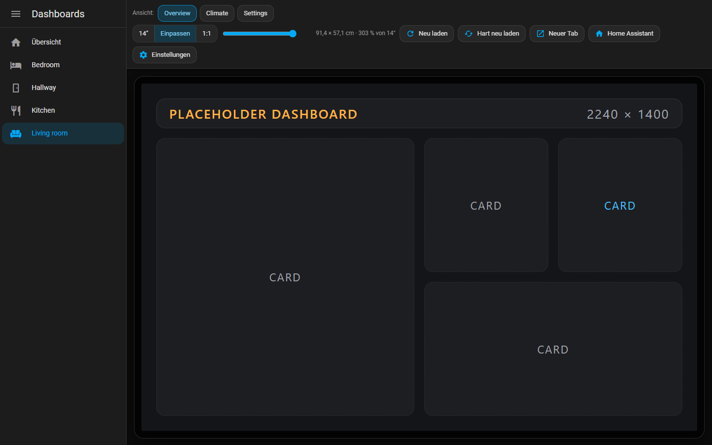

# Dashboard Viewer



*(mock-up) – the real viewer page with a stubbed Home Assistant connection, sample dashboard names and a placeholder dashboard in the tablet frame; the UI is German*

Static page for Home Assistant that previews your dashboards the way they look on a wall tablet. Each dashboard is rendered in an iframe at a fixed resolution (default **2240 × 1400**) and only scaled, so the layout is identical to the real device.

- Buttons at the top list **all dashboards** (loaded live from Home Assistant via `get_panels`), below them the views of the selected dashboard.
- Scaling modes:
  - **14″** – real tablet size on your monitor (computed from monitor diagonal + resolution, can be calibrated with a ruler)
  - **Fit** – as large as the window allows
  - **1:1** – one tablet pixel = one monitor pixel
  - slider – free zoom in % of the 14″ size
- Settings (resolution, tablet/monitor size, kiosk mode, optional tablet bezel, show system panels) are stored in the browser's `localStorage`.
- Optional sidebar panel (`panel.js`) shows the viewer inside Home Assistant and can open it in a new tab or in a separate popup window (position/size remembered).

Because the page is served by Home Assistant itself (`/local/…`), the iframes are same-origin: no X-Frame-Options problems and the existing login is reused (the page reads the HA frontend's `hassTokens` from `localStorage`).

UI language: German.

## Installation

1. Copy `index.html` and `panel.js` to `/config/www/dashboard-viewer/`.
2. Log in to Home Assistant in the browser, then open `http://<your-ha>:8123/local/dashboard-viewer/index.html`.

### Optional: sidebar entry

Either a simple webpage dashboard (replacement for the old `panel_iframe`): Settings → Dashboards → **Add dashboard** → **Webpage** → URL `/local/dashboard-viewer/index.html`.

Or the custom panel with "reload / new tab / new window" buttons:

```yaml
# configuration.yaml
panel_custom:
  - name: dashboard-viewer-panel
    url_path: dashboard-vorschau
    sidebar_title: Dashboard Viewer
    sidebar_icon: mdi:monitor-dashboard
    module_url: /local/dashboard-viewer/panel.js?v=1   # bump the number after updates (browser cache)
```

Restart Home Assistant after editing `configuration.yaml`. The viewer hides the panel with url_path `dashboard-vorschau` from its own dashboard list – if you use a different `url_path`, the panel will also appear as a button (harmless).

## URL parameters

All optional: `?dash=my-dashboard&view=1&mode=real|fit|pixel&w=2240&h=1400`

## Notes

- No dashboards or addresses are hard-coded; the list always comes from your Home Assistant.
- The page loads the Material Design Icons font from `cdn.jsdelivr.net`.
- Only tested with the author's own Home Assistant instance and Chromium-based browsers.

## Version

1.0.0

## License

MIT – see [LICENSE](LICENSE).
